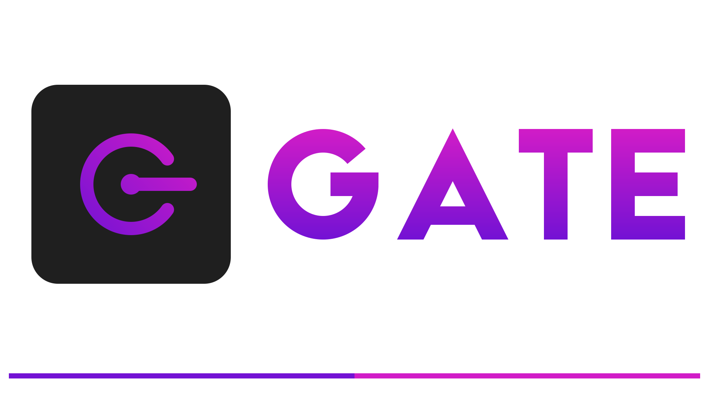
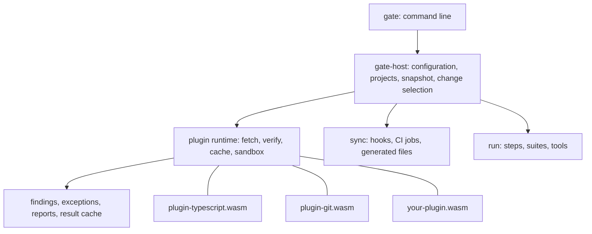
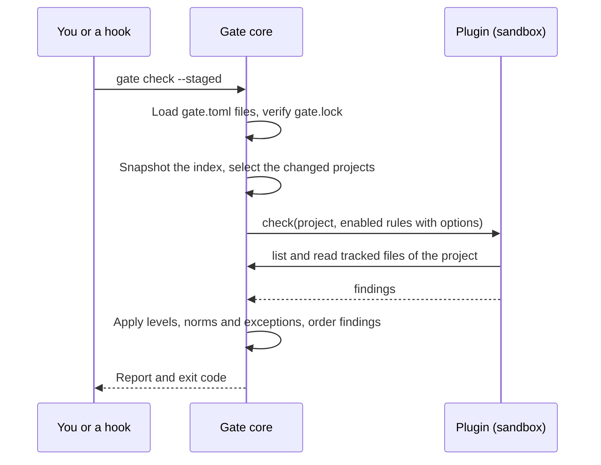

<a id="top"></a>

<p align="center">
  
</p>

<h1 align="center">🚦 Gate</h1>
<p align="center"><em>A modular repository linter and gate: a small core that runs your rules from pinned, sandboxed WebAssembly plugins, on one project or on every project of a monorepo.</em></p>

<p align="center">
    <a aria-label="ElsiKora logo" href="https://elsikora.com">
  
</a>      
</p>

> [!NOTE]
> `v0.2.1` is the current release: the core, the plugin runtime, the Rust SDK, the launcher and
> seven shared plugins, `git` and `nestjs` at 0.2.1 and the others at 0.2.0. What changes from one
> release to the next is in the [changelog](CHANGELOG.md).

## 💡 Highlights

- 🧩 The core holds no rule. Every rule, generator and language is a plugin: one `.wasm` file, the same
  on every platform, pinned by version and sha256 in a committed `gate.lock`.
- 🔒 Plugins run in a sandbox. A plugin sees the tracked files of its project, read-only, and nothing
  else: no file writes, no network, no clock, no environment.
- 🗂️ Monorepos are first-class. Each project carries its own `gate.toml`; a change runs only the projects
  it touches and the projects that depend on them.
- ⚡ Results are cached exactly. The core records every file a plugin read, so a run whose inputs did not
  change is not run again.

## 📚 Table of Contents

- [Description](#-description)
- [Tech Stack](#-tech-stack)
- [Features](#-features)
- [Architecture](#-architecture)
- [Project Structure](#-project-structure)
- [Prerequisites](#-prerequisites)
- [Installation](#-installation)
- [Usage](#-usage)
- [Plugins](#-plugins)
- [Guides](#-guides)
- [Roadmap](#-roadmap)
- [FAQ](#-faq)
- [Contributing](#-contributing)
- [License](#-license)
- [Acknowledgments](#-acknowledgments)

## 📖 Description

A repository has rules that no compiler checks: how commits are written, which module may import which,
that every decision record has a status, that the documentation links resolve, that the hooks and the
CI job call what the repository says they call. Gate checks them. You write the rules down once, in
`gate.toml`, and Gate checks the same rules in the pre-commit hook, on push and in CI.

The core is the tool and nothing more: it reads the configuration, finds the projects of the
repository, takes a snapshot of the tracked files (of the working tree, the index or a commit), selects
what a change touches, runs the plugins and reports findings as text, JSON, SARIF or GitHub
annotations. Everything that knows about code lives in plugins, and a plugin is a WebAssembly component:
built once, verified by checksum, run in a sandbox. A team can write a plugin for its own conventions in
an afternoon and pin it the way it pins the core.

### Real-World Use Cases

- **One gate for every hook**: the same rules run in `pre-commit` on the staged files, in `pre-push`
  on the pushed range and in CI on the pull request, so nothing passes locally that fails in CI.
- **A monorepo with many teams**: each project keeps its own plugins and rules in its own `gate.toml`;
  a change to one package checks that package and its dependents, not the whole tree.
- **House conventions as code**: commit subjects, branch names, import directions, record statuses and
  generated agent rule files become rules with written norms, and every finding names the norm it
  enforces.
- **Exceptions that only shrink**: an exception needs a reason, and an exception that no longer matches
  anything is itself reported.

## 🛠️ Tech Stack

| Category | Technologies |
| --- | --- |
| **Language** | Rust (stable, pinned in `rust-toolchain.toml`), `unsafe` forbidden |
| **Plugin form** | WebAssembly components (WASI 0.2), interface in WIT |
| **Runtime** | `wasmtime`, embedded in the core |
| **Command line** | `clap` |
| **Configuration** | TOML, validated against JSON Schema |
| **Git** | the `git` binary through one small module |
| **Reports** | text, JSON, SARIF, GitHub annotations |
| **Distribution** | GitHub releases with `SHA256SUMS`; a committed POSIX launcher |

## 🚀 Features

- ✨ **A core with no rule**: configuration, projects, snapshots, change selection, the plugin runtime,
  findings, reports, cache, hooks, CI jobs, steps and `doctor`. Nothing in it names a language or a
  framework.
- ✨ **Plugins pinned like the core**: one source form, `<owner>/<repo>:<plugin>@<version>`, resolved to a
  URL and a sha256 in `gate.lock`. A checksum mismatch fails closed; private plugins are fetched with a
  GitHub token.
- ✨ **A local plugin for one run**: `--plugin <name>=<file.wasm>` tries a changed plugin before its
  release. It exists only on the command line, never enters the cache, and generated CI jobs refuse it.
- ✨ **Sandboxed, deterministic plugins**: a plugin reads only what the core hands it; rules that need
  git history declare it and get a read-only view of commits.
- ✨ **Strict configuration**: unknown keys, unknown rules, options that fail a rule's schema and
  exceptions without a reason are errors that name the file and the key.
- ✨ **Levels and norms in configuration**: `error`, `warning`, `note` or `off` per rule or aspect, and the
  repository's own rule id (`norm = "RULE-IMP-001"`) printed with every finding.
- ✨ **Projects from the package manager**: pnpm workspaces, the `workspaces` of `package.json` (npm
  and yarn), explicit globs, or nested `gate.toml` files; a path belongs to the project with the
  longest root that contains it.
- ✨ **Profiles**: project settings for sets of projects, written once in the root file;
  `gate list --origin` shows where every setting of every project came from.
- ✨ **Change selection**: `--staged`, `--changed --base <rev>`, `--push <base>..<tip>`; the report says
  which projects ran and which were skipped and why.
- ✨ **Exact result cache**: keyed by the plugin's sha256, the rules and options, and the blob ids of
  every file the plugin read; shared by every worktree, outside the repository.
- ✨ **Generated files, verified**: `gate sync` writes the git hooks, the CI jobs and the files plugins
  generate; `gate sync --check` reports drift.
- ✨ **Steps and suites**: run the repository's own commands (format, lint, tests) as named suites, per
  project or at the root, on the staged or changed files only if you like, with external tools pinned by
  version and sha256.
- ✨ **Baselines and exceptions that only shrink**: adopt a rule on an old codebase with
  `gate baseline write`; an entry or an exception that matches nothing is reported.
- ✨ **Time budgets**: `--budget` warns when a run is slow, `--budget-fails` fails it; `--timings` prints
  the time of each phase of the run.
- ✨ **Deterministic reports**: findings ordered by path, line, column, rule, aspect and message, with a
  stable fingerprint for baselines and SARIF.

## 🏗 Architecture

### System Architecture



### A Check, Step by Step



The full design is in [docs/architecture.md](docs/architecture.md).

## 📁 Project Structure

```
Gate/
├── crates/gate/           # The command line
├── crates/gate-host/      # The core: configuration, projects, snapshot, git, cache, report, sync, run
├── crates/gate-runtime/   # The plugin runtime: WebAssembly components under wasmtime, sandboxed
├── crates/gate-sdk/       # The Rust SDK for plugin authors
├── crates/gate-test/      # The fixture harness for plugins
├── wit/                   # The plugin interface (gate:plugin)
├── languages/typescript/  # The TypeScript language library
├── plugins/               # The shared plugins: typescript, git, markdown, agents, ledger, nestjs, ci
├── examples/              # A minimal plugin, built in CI
├── scripts/               # Release and build scripts, the reproducible component build
├── spike/                 # The measurement that chose the plugin form (spike/RESULTS.md)
├── docs/architecture.md   # The design
├── docs/guide/            # The guides
├── rust-toolchain.toml    # The pinned Rust toolchain
├── deny.toml              # Licence and advisory policy for cargo-deny
└── LICENSE                # MIT
```

## 📋 Prerequisites

- macOS on Apple silicon (`aarch64-apple-darwin`) or Linux on x86-64 (`x86_64-unknown-linux-musl`)
- `git` on `PATH`
- A POSIX shell and `curl` for the launcher
- To build from source or write a plugin: Rust through `rustup` (the toolchain installs itself from
  `rust-toolchain.toml`)

## 🛠 Installation

### From a Release

Gate is installed into a repository, not onto a machine. The release archive is only needed once, to
run `gate init`. Run these in the root of your repository; the last line removes the downloaded
files:

```bash
version=0.2.1
target=aarch64-apple-darwin          # or x86_64-unknown-linux-musl
curl -fsSLO "https://github.com/ElsiKora/Gate/releases/download/v${version}/gate-${target}.tar.gz"
curl -fsSLO "https://github.com/ElsiKora/Gate/releases/download/v${version}/SHA256SUMS"
shasum -a 256 -c SHA256SUMS --ignore-missing
tar -xzf "gate-${target}.tar.gz"
./gate init
rm gate "gate-${target}.tar.gz" SHA256SUMS
```

`gate init` writes a starting `gate.toml`, `gate.lock` and `bin/gate`, a short POSIX launcher you
commit. From then on everyone, every hook and every CI job runs `bin/gate`: it reads the core's version
and sha256 from `gate.lock`, downloads the archive once into the cache, verifies it and runs it.

> [!IMPORTANT]
> Commit `gate.toml`, `gate.lock` and `bin/gate`. A run whose lock does not match the configuration
> fails, and a checksum that does not match fails closed.

### From Source

```bash
git clone https://github.com/ElsiKora/Gate.git
cd Gate
cargo build --release --locked
./target/release/gate --help
```

### Development Setup

```bash
cargo fmt --all --check
cargo clippy --locked --all-targets -- -D warnings
cargo test --locked
cargo deny --locked check
```

See [CONTRIBUTING.md](CONTRIBUTING.md) before you open a pull request.

## 💡 Usage

### One Project

A repository with one project needs one `gate.toml` at its root:

```toml
[gate]
version = "0.2.1"

[plugins]
markdown = { source = "ElsiKora/Gate:markdown@0.2.0" }

[plugins.git]
source = "ElsiKora/Gate:git@0.2.1"

[plugins.git.options]
main = ["refs/remotes/origin/main", "refs/heads/main"]
activation = "<the output of git rev-parse HEAD>"  # the commit the policy starts after
release-subject = '^chore\(release\): (\d+\.\d+\.\d+)$'

[rules]
"git/no-ci-skip" = "error"
"git/commit-message" = "error"

[hooks]
pre-commit = ["check --staged"]
commit-msg = ["check --commit-message"]
pre-push = ["check --push"]
```

Write the commit the git rules start after in place of `<the output of git rev-parse HEAD>`: for a
new policy, the output of `git rev-parse HEAD`. Gate reads only tracked files, and the
pre-commit hook only staged ones, so add each file Gate writes:

```bash
git add gate.toml gate.lock bin/gate
bin/gate lock                 # resolve the plugins and write their checksums to gate.lock
bin/gate sync                 # write the git hooks
git add gate.lock .githooks
bin/gate check                # check the working tree
```

Then commit the files you added:

```bash
git commit -m "chore(gate): add gate"
```

The `commit-msg` hook checks the message being written, before the commit exists: its form
`<type>(<scope>): <subject>` (`git/commit-message`, where a scope is required by default; the
[rule page](plugins/git/rules/commit-message.md) explains how to change that) and no CI-skip
directive (`git/no-ci-skip`).

The [getting started guide](docs/guide/getting-started.md) walks through it.

### A Monorepo

The root `gate.toml` says where the projects are, holds the repository-scope rules, and gives sets of
projects their settings through profiles; a project with needs of its own adds its own `gate.toml`:

```toml
# gate.toml
[gate]
version = "0.2.1"

[workspace]
projects = "pnpm"                 # from pnpm-workspace.yaml; or a list of globs
ignore = ["samples/**"]

[plugins.git]
source = "ElsiKora/Gate:git@0.2.1"

[plugins.git.options]
main = ["refs/remotes/origin/main", "refs/heads/main"]
activation = "<the output of git rev-parse HEAD>"  # the commit the policy starts after
release-subject = '^chore\(release\): (\d+\.\d+\.\d+)$'

[rules]
"git/no-ci-skip" = "error"
"git/commit-message" = "error"

[[profiles]]
projects = ["apps/*", "packages/*"]

[profiles.plugins]
typescript = { source = "ElsiKora/Gate:typescript@0.2.0" }
```

```toml
# apps/server/gate.toml
[project]
name = "server"

[plugins]
nestjs = { source = "ElsiKora/Gate:nestjs@0.2.1" }

[rules."nestjs/import-direction"]
level = "error"
norm = "RULE-IMP-001"

[[rules."nestjs/import-direction".options.contracts]]
source-directory = "src/modules/domain"
aspect = "domain-direction"
forbidden-owner-paths = ["src/modules/public"]
forbidden-packages = ["@nestjs/swagger"]
```

```bash
git add gate.toml apps/server/gate.toml
bin/gate lock                               # pin the plugins the new files name
git add gate.lock
bin/gate list --origin                      # projects, plugins and rules, and where each came from
bin/gate check --changed --base origin/main # only the projects a change touches, and their dependents
git commit -m "chore(gate): add gate"
```

Once `gate sync` wires the hooks, the `commit-msg` hook checks `<type>(<scope>): <subject>`, a scope
is required by default, and the [rule page](plugins/git/rules/commit-message.md) explains how to
change that.

The [monorepo guide](docs/guide/monorepo.md) covers discovery, ownership, profiles and change
selection.

### Commands

| Command | What it does |
| --- | --- |
| `gate check` | Check the tracked files of the working tree |
| `gate check --staged` | Check the index (pre-commit) |
| `gate check --changed --base <rev>` | Check the projects changed since `<rev>` and their dependents |
| `gate check --push <base>..<tip>` | Check the range being pushed; in `[hooks]` and CI jobs write `--push` alone, the hook or job passes the range |
| `gate check --commit-message <file>` | Check a commit message (commit-msg) |
| `gate check --rev <oid>` | Check one commit |
| `gate check --plugin <name>=<file.wasm>` | Check with a local build in place of one pinned plugin, for this run only |
| `gate list` / `gate list --origin` | Print projects, plugins, rules and what is turned off; with `--origin`, the file and section of each setting |
| `gate explain <plugin>/<rule>` | Print what the configuration says about a rule (levels, norms, origins, exceptions), or that no `gate.toml` configures it |
| `gate schema` / `gate schema --exceptions` | Print the JSON Schema of `gate.toml`, or of `gate.exceptions.toml` |
| `gate lock` | Resolve the core and plugins and write `gate.lock` |
| `gate lock --set <name>=<url> --sha256 <hash>` | Move one pin, from a plugin's release job |
| `gate baseline write` | Store today's findings in `gate/baseline.json`; they stop being reported |
| `gate sync` / `gate sync --check` | Write, or verify, hooks, CI jobs and generated files |
| `gate run <suite or step>` | Run the repository's steps and report each exit code; takes `--staged`, `--changed --base <rev>` or `--push <base>..<tip>` |
| `gate doctor` | Check the installation, the hooks of this clone and the working copy |
| `gate cache prune [<repository>...]` / `--older-than <days>` / `--max-size <size>` / `--yes` | List the downloads no `gate.lock` of the repositories pins, the results and git answers nothing can use, and, with a bound, those last used longer ago or the least recently used over the size; with `--yes`, remove them. A pinned download is never removed |
| `gate init` | Write `gate.toml`, `gate.lock` and `bin/gate` |

Options of `gate check`: `--format text|json|sarif|github`, `--rule <plugin>/<rule>` (repeatable),
`--timings`, `--budget <seconds>` (warns), `--budget-fails` (makes an exceeded budget an error),
`--fail-fast`, `--no-overrides` (refuses `--plugin`). `gate list` takes `--format text|json`.

Exit codes: `0` clean, `1` errors found, `2` a configuration or environment failure.

### Hooks and CI

```toml
[steps]
format = { run = "pnpm prettier --check", files = "staged", glob = "*.{ts,md}" }

[hooks]
pre-commit = ["check --staged", "run format"]
pre-push = ["check --push"]
budget = 10

[ci.github]
workflow = ".github/workflows/gate.yml"
checkout = "actions/checkout@3d3c42e5aac5ba805825da76410c181273ba90b1"   # v7.0.1
aggregate = "gate-passed"

[ci.github.jobs.gate]
name = "Gate"
runs-on = "ubuntu-latest"
run = ["check --push"]
```

`gate sync` writes the hooks, sets `core.hooksPath` once per clone (every worktree shares it) and
writes the workflow. The workflow's generated first job runs `gate sync --check`, which reports drift
between the generated files and `gate.toml`, and lists the projects the change touches. The hooks
never skip themselves on an environment variable. In a hook or a job, `--push` takes no value: the
hook passes each pushed range, the job the pull request's or the push's range. Generated `check`
commands get `--no-overrides`, and `--budget <seconds> --budget-fails` when the job sets `budget`; a
job that lists `projects` is skipped when none of them changed. `aggregate` adds one job that needs
every other job, always runs, and fails unless each of them succeeded or was skipped: the single
check to require in branch protection.

## 🧩 Plugins

| Plugin | What it checks |
| --- | --- |
| `typescript` | Every tracked TypeScript and JavaScript source parses. Also the language library other plugins link. |
| `git` | Commit history rules |
| `markdown` | Documentation front matter, local links and required sections |
| `agents` | Agent rule files and skills; generates the Claude Code adapters and the `AGENTS.md` rule table |
| `ledger` | Decision ledger records, statuses, blockers and closers, and the decisions and owners exceptions cite |
| `nestjs` | NestJS services built on [NestJS-Crud-Automator](https://github.com/ElsiKora/NestJS-Crud-Automator) |
| `ci` | GitHub Actions workflows: actions pinned by commit, `workflow_run` targets that exist |

The [plugins guide](docs/guide/plugins.md) lists their rules and options. Your own plugin is pinned the
same way as these: see [writing a plugin](docs/guide/writing-a-plugin.md).

## 📘 Guides

| Guide | For |
| --- | --- |
| [Getting started](docs/guide/getting-started.md) | Install Gate in a repository and run the first check |
| [Configuration](docs/guide/configuration.md) | Every section of `gate.toml`, `gate.exceptions.toml` and `gate.lock` |
| [Monorepo](docs/guide/monorepo.md) | Projects, ownership, change selection, dependents |
| [Plugins](docs/guide/plugins.md) | The shared plugins and their rules |
| [Writing a plugin](docs/guide/writing-a-plugin.md) | Build, test, release and pin a plugin |
| [Writing a rule](docs/guide/writing-a-rule.md) | Options, reading files and history, findings, fixtures |

## 🛣 Roadmap

| Task / Feature | Status |
| --- | --- |
| Architecture: a core with no rule, plugins for everything | ✅ Done |
| Plugin form measured: WebAssembly components | ✅ Done |
| Core: configuration, projects, snapshots, change selection, reports | ✅ Done |
| Plugin interface, runtime, Rust SDK, fixture harness | ✅ Done |
| Lock, verified fetch, cache, launcher, release workflow | ✅ Done |
| Hooks, CI jobs, steps, suites, tools, `doctor` | ✅ Done |
| Shared plugins: `typescript`, `git`, `markdown`, `agents`, `ledger`, `nestjs`, `ci` | ✅ Done |
| `v0.1.0`, the first public release | ✅ Done |
| Faster full checks on large trees and long histories | 🚧 In Progress |
| `git`: branch names and commit messages | 🚧 In Progress |
| `typescript/barrel-imports` | 🚧 In Progress |
| Cargo and Go workspace discovery | 🚧 In Progress |

## ❓ FAQ

<details>
<summary><strong>Why is every rule a plugin?</strong></summary>

So the core stays small and the same for everyone. A rule for one framework, or for one team's own
conventions, is released and versioned on its own, and a repository pins exactly the rules it runs.
Adding a language is a new plugin; the core does not change.

</details>

<details>
<summary><strong>Why WebAssembly?</strong></summary>

One file runs on every platform, so a plugin has one checksum. The sandbox means a plugin cannot read
anything the core did not hand it, which is what makes the result cache exact and a third-party plugin
safe to run. You write plugins in Rust with the SDK, or in any language that builds WebAssembly
components.

</details>

<details>
<summary><strong>Does Gate replace ESLint, Clippy or my test runner?</strong></summary>

No. Those stay the tools for what they do; Gate runs them as steps (`[steps]`, `[suites]`) and reports
their exit codes. Gate's own rules are the ones those tools do not cover: rules across files, across
projects and across the git history.

</details>

<details>
<summary><strong>Does a CI job or a new laptop need Rust?</strong></summary>

No. `bin/gate` downloads the released core and plugins, verifies their checksums and caches them. Only a
plugin's author needs a Rust toolchain, to build the plugin.

</details>

<details>
<summary><strong>How do I silence a finding?</strong></summary>

Add an `[[exception]]` entry to the `gate.exceptions.toml` beside the project's `gate.toml`, with the
rule, the target and a reason, and optionally the decision it follows. An exception that matches
nothing is reported, so the list only shrinks. To adopt a new rule on a codebase with many existing
findings, write a baseline (`gate baseline write`) instead, and work it down. There are no
suppression comments in source files. See the
[configuration guide](docs/guide/configuration.md#exceptions).

</details>

## 🤝 Contributing

Issues and pull requests are welcome. Read [CONTRIBUTING.md](CONTRIBUTING.md) for the workflow and
[SECURITY.md](SECURITY.md) to report a vulnerability privately. Changes are listed in
[CHANGELOG.md](CHANGELOG.md).

## 🔒 License

This project is licensed under the **MIT License**. See [LICENSE](LICENSE).

## 🙏 Acknowledgments

- Built and maintained by [ElsiKora](https://github.com/ElsiKora)
- Plugins run on [Wasmtime](https://github.com/bytecodealliance/wasmtime) of the Bytecode Alliance
- TypeScript is parsed by [oxc](https://github.com/oxc-project/oxc)
- The command line is built with [clap](https://github.com/clap-rs/clap)

---

<p align="center">
  <a href="#top">Back to Top</a>
</p>
